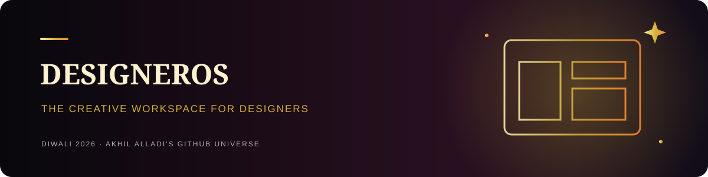

<p align="center"><a href="https://akhilalladi-code.github.io/diwali-universe/"><strong>🪔 Explore Diwali Universe 2026 · Interactive celebration ↗</strong></a></p>

# DesignerOS ✳

**The creative workspace for graphic designers.** An open-source home for everyday design utilities and creative workflows.

## Implemented features

- Responsive workspace dashboard, navigation and light/dark theme
- **Color Studio:** HEX, RGB, HSL, palette variations, gradient CSS and WCAG contrast ratio
- **Typography Studio:** modular type scale and live type specimen
- **Image Toolkit:** local image preview and JPEG optimization/export
- **Design Calculators:** pixel/DPI print dimensions, millimeter conversion and common print presets
- **Social Presets:** searchable dimensions for Instagram, Facebook, LinkedIn, YouTube, Pinterest and X
- **Projects:** create/delete with browser-local persistence

## Run locally

Requires Node.js 20.9+.

```bash
git clone https://github.com/akhilalladi-code/designer-os.git
cd designer-os
npm install
cp .env.example .env.local
npm run dev
```

Open http://localhost:3000.

## Quality checks

```bash
npm run typecheck
npm run lint
npm test
npm run build
```

No environment variables are needed for implemented local-first tools. Future AI/Supabase integrations are optional and require server-side secrets. Image processing runs in the browser; project data currently stays in localStorage on the current browser and does not sync across devices.

See [feature status](docs/FEATURES.md), [contributing](.github/CONTRIBUTING.md), and [security policy](SECURITY.md). MIT licensed.
